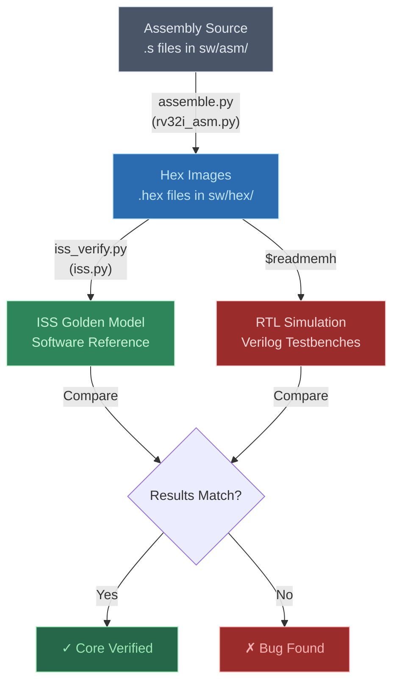
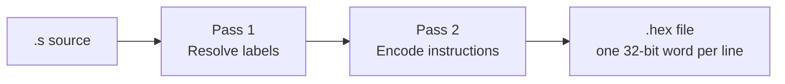
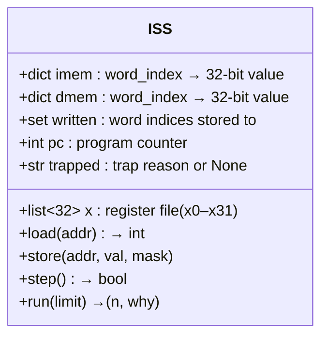
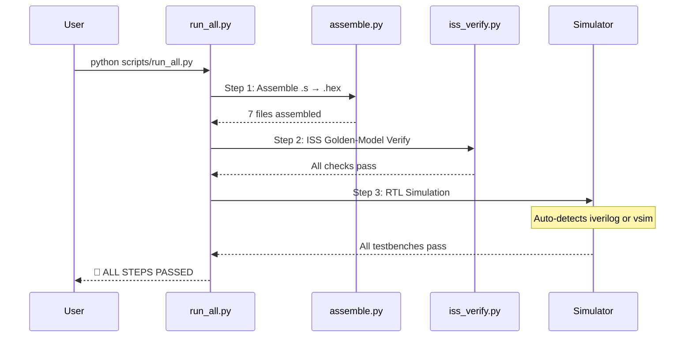
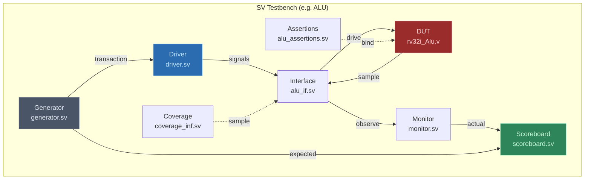
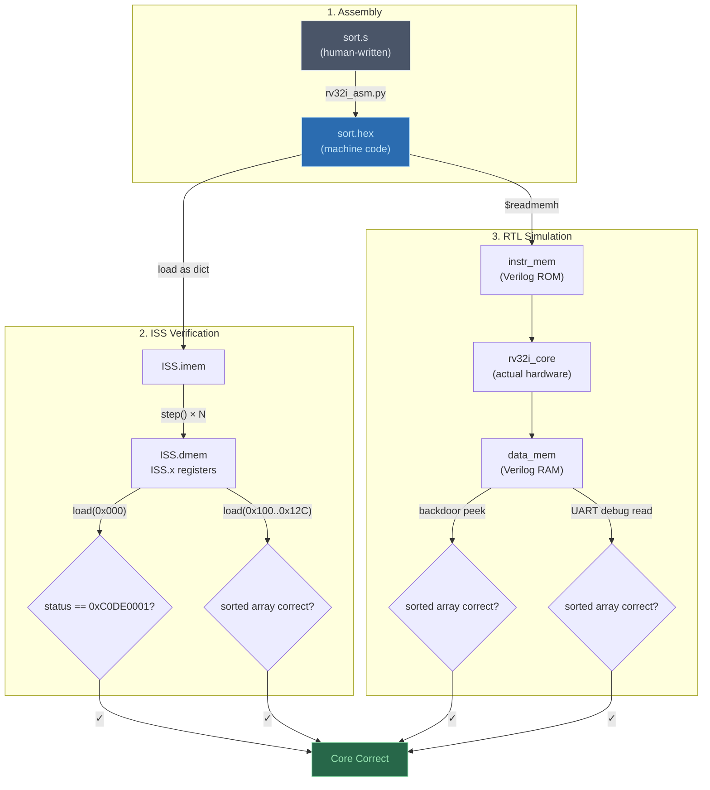

# 🔍 1TOPS RV32I Core — Python Verification Analysis

> A detailed breakdown of how every Python script in this project contributes to verifying the correctness of the RV32I (Zeroriscy) processor core.

---

## 📐 High-Level Verification Architecture

The project uses a **three-tier verification strategy**, entirely orchestrated by Python:



Additionally, there is a **fourth tier** for unit-level component verification using SystemVerilog UVM-style testbenches, managed by a separate Python runner.

---

## 📁 Script Inventory

| Script | Location | Role |
|--------|----------|------|
| [rv32i_asm.py](file:///c:/Users/LENOVO/Downloads/1TOPS_SILICON-main/1TOPS_SILICON-main/sw/rv32i_asm.py) | `sw/` | Custom two-pass RV32I assembler |
| [iss.py](file:///c:/Users/LENOVO/Downloads/1TOPS_SILICON-main/1TOPS_SILICON-main/sw/iss.py) | `sw/` | Instruction-Set Simulator (golden model) |
| [assemble.py](file:///c:/Users/LENOVO/Downloads/1TOPS_SILICON-main/1TOPS_SILICON-main/scripts/assemble.py) | `scripts/` | Batch driver: assembles all `.s` → `.hex` |
| [iss_verify.py](file:///c:/Users/LENOVO/Downloads/1TOPS_SILICON-main/1TOPS_SILICON-main/scripts/iss_verify.py) | `scripts/` | Runs ISS on every hex image and checks correctness |
| [run_all.py](file:///c:/Users/LENOVO/Downloads/1TOPS_SILICON-main/1TOPS_SILICON-main/scripts/run_all.py) | `scripts/` | Master orchestrator: assemble → ISS → RTL sim |
| [run_verification.py](file:///c:/Users/LENOVO/Downloads/1TOPS_SILICON-main/1TOPS_SILICON-main/1TOPS_VERIFICATION/run_verification.py) | `1TOPS_VERIFICATION/` | Drives QuestaSim for 15 component-level SV testbenches |

---

## 🔧 Tier 1 — The Custom Assembler

### Script: [rv32i_asm.py](file:///c:/Users/LENOVO/Downloads/1TOPS_SILICON-main/1TOPS_SILICON-main/sw/rv32i_asm.py) (297 lines)

**Purpose:** Converts hand-written RISC-V assembly (`.s` files) into flat hex images (`.hex` files) that both the ISS and the Verilog `$readmemh` can consume.

### How It Works



**Pass 1 — Label Resolution (lines 243–252):**
- Scans every line, tracking the current PC (program counter)
- When it hits a `label:`, it records `labels[label] = current_pc`
- When it hits an instruction mnemonic, it advances `pc += 4 * inst_size(mnem, ops)`
- The `li` pseudo-instruction is variable-length: 1 word if the immediate fits in 12 signed bits, 2 words (`lui` + `addi`) otherwise

**Pass 2 — Encoding (lines 255–273):**
- Walks the same parsed items again
- Calls `encode(mnem, ops, pc, labels)` which pattern-matches the mnemonic against dictionaries for each instruction format:

| Format | Dictionary | Instructions |
|--------|------------|--------------|
| R-type | `R_TYPE` | `add`, `sub`, `sll`, `slt`, `sltu`, `xor`, `srl`, `sra`, `or`, `and` |
| I-type | `I_TYPE` | `addi`, `slti`, `sltiu`, `xori`, `ori`, `andi` |
| Shift-I | `SHIFT_I` | `slli`, `srli`, `srai` |
| Load | `LOAD` | `lb`, `lh`, `lw`, `lbu`, `lhu` |
| Store | `STORE` | `sb`, `sh`, `sw` |
| Branch | `BRANCH` | `beq`, `bne`, `blt`, `bge`, `bltu`, `bgeu` |
| U-type | direct | `lui`, `auipc` |
| J-type | direct | `jal`, `jalr` |
| Pseudo | special | `nop`, `li`, `j` |

- Each encoder produces the exact 32-bit machine word by bit-shifting fields (opcode, rd, funct3, rs1, rs2, funct7, immediates) into position
- Register names accept both ABI names (`a0`, `sp`, `ra`, etc.) and numeric (`x0`–`x31`)

**Output Format:**
```
00000013    ← word 0 (address 0x000) — NOP
00000013    ← word 1 (address 0x004) — NOP
...
0100006f    ← word 32 (address 0x080) — jal x0, _start
```
One hex word per line, starting from address 0. Empty slots are filled with `NOP` (`0x00000013`).

### Batch Driver: [assemble.py](file:///c:/Users/LENOVO/Downloads/1TOPS_SILICON-main/1TOPS_SILICON-main/scripts/assemble.py) (137 lines)

- Dynamically imports `rv32i_asm.py` via `importlib.util` (no subprocess needed)
- Scans `sw/asm/` for all `.s` files (or specific names if given)
- Calls `asm_mod.assemble(source_text)` → gets back `(image_dict, labels_dict)`
- Writes the hex file to `sw/hex/`
- Reports instruction count, address range, and label map

### Test Programs Available

| Program | File | What It Tests |
|---------|------|---------------|
| `sort` | [sort.s](file:///c:/Users/LENOVO/Downloads/1TOPS_SILICON-main/1TOPS_SILICON-main/sw/asm/sort.s) | Bubble sort of 12 signed integers — exercises `lui`, `addi`, `slli`, `add`, `lw`, `sw`, `beq`, `bge`, `jal` |
| `fib` | [fib.s](file:///c:/Users/LENOVO/Downloads/1TOPS_SILICON-main/1TOPS_SILICON-main/sw/asm/fib.s) | First 12 Fibonacci numbers |
| `gcd` | [gcd.s](file:///c:/Users/LENOVO/Downloads/1TOPS_SILICON-main/1TOPS_SILICON-main/sw/asm/gcd.s) | GCD(1071, 462) = 21 |
| `rv32i_compliance` | [rv32i_compliance.s](file:///c:/Users/LENOVO/Downloads/1TOPS_SILICON-main/1TOPS_SILICON-main/sw/asm/rv32i_compliance.s) | Full 41-subtest compliance: every R/I/S/B/U/J instruction |
| `mul` | [mul.s](file:///c:/Users/LENOVO/Downloads/1TOPS_SILICON-main/1TOPS_SILICON-main/sw/asm/mul.s) | Software multiply (no M extension) |
| `primes` | [primes.s](file:///c:/Users/LENOVO/Downloads/1TOPS_SILICON-main/1TOPS_SILICON-main/sw/asm/primes.s) | Prime sieve |
| `strlen_rev` | [strlen_rev.s](file:///c:/Users/LENOVO/Downloads/1TOPS_SILICON-main/1TOPS_SILICON-main/sw/asm/strlen_rev.s) | String length & reverse |

---

## 🧠 Tier 2 — The ISS Golden Model

### Script: [iss.py](file:///c:/Users/LENOVO/Downloads/1TOPS_SILICON-main/1TOPS_SILICON-main/sw/iss.py) (273 lines)

**Purpose:** A complete, independent, pure-Python implementation of the RV32I instruction set. It executes the same `.hex` image the hardware runs, so any mismatch **points at the RTL core**, not at the test program or assembler.

### ISS Architecture



### Execution Loop (`step()` method, lines 60–140)

Each call to `step()`:

1. **Fetches** the instruction: `ins = self.imem.get(self.pc >> 2, 0)`
2. **Decodes** all fields in parallel:
   ```
   op  = ins[6:0]      # opcode
   rd  = ins[11:7]     # destination register
   f3  = ins[14:12]    # funct3
   rs1 = ins[19:15]    # source register 1
   rs2 = ins[24:20]    # source register 2
   f7  = ins[31:25]    # funct7
   ```
3. **Executes** by matching on the opcode:

| Opcode | Name | What the ISS does |
|--------|------|-------------------|
| `0x37` | LUI | `rd = ins & 0xFFFFF000` |
| `0x17` | AUIPC | `rd = pc + (ins & 0xFFFFF000)` |
| `0x6F` | JAL | `rd = pc+4; pc = pc + imm` (J-type immediate extraction) |
| `0x67` | JALR | `rd = pc+4; pc = (rs1 + imm) & ~1` |
| `0x63` | Branches | Computes condition (BEQ/BNE/BLT/BGE/BLTU/BGEU), sets `pc = pc + imm` if taken |
| `0x03` | Loads | Computes effective address, reads from `dmem`, sign/zero-extends based on funct3 |
| `0x23` | Stores | Computes effective address, writes to `dmem` with byte/half/word mask |
| `0x13/0x33` | ALU | Performs the arithmetic/logic operation (ADD/SUB/SLL/SLT/XOR/SRL/SRA/OR/AND) |

4. **Advances PC**: `self.pc = npc & M32`

### Halt Detection

The `run(limit)` method (lines 142–149) detects program completion by checking if the PC is unchanged after a step — this catches the `j halt` (jump-to-self) parking loop that every test program uses:

```python
if self.pc == prev:    # `j self` parking loop
    return n, "halted"
```

### Memory Model

- **Instruction memory** (`imem`): Dict loaded from the hex file. Read-only.
- **Data memory** (`dmem`): Dict initialized empty. Byte-addressed but stored as words. Sub-word accesses use shift-and-mask.
- **`written` set**: Tracks which word indices the program has stored to — used for auto-dumping all touched memory.

---

## ✅ Tier 2b — ISS Verification Driver

### Script: [iss_verify.py](file:///c:/Users/LENOVO/Downloads/1TOPS_SILICON-main/1TOPS_SILICON-main/scripts/iss_verify.py) (247 lines)

**Purpose:** Runs the ISS on every `.hex` image and performs **three categories of checks**:

### Check Category 1: Execution Health
```python
check(why == "halted", ...)       # Program must halt (not hit instruction limit)
```

### Check Category 2: Convention Compliance
Every test program uses the same data-memory convention:
```python
status = iss.load(0x000)          # Must be 0xC0DE0001 (done flag)
trapmk = iss.load(0x004)          # Must be 0x00000000 (no exception fired)
```

### Check Category 3: Program-Specific Data Validation

The script has a hardcoded `EXPECTED` dictionary with the **exact output** each program must produce:

| Test | What's Checked | Detail |
|------|----------------|--------|
| `sort` | 12 words at `0x100–0x12C` | Must be `[-999, -128, -7, -1, 0, 3, 5, 19, 42, 77, 255, 1000]` (sorted ascending) |
| `fib` | 12 words at `0x100–0x12C` | Must be `[0, 1, 1, 2, 3, 5, 8, 13, 21, 34, 55, 89]` (Fibonacci sequence) |
| `gcd` | 1 word at `0x100` | Must be `21` (GCD of 1071 and 462) |
| `rv32i_compliance` | 42 words at `0x0FC–0x1A0` | Pass count = 41, plus 41 individual `1`s for every RV32I instruction subtest |

> [!IMPORTANT]
> The compliance test is the most critical: it individually tests **all 41 base RV32I operations** (ADD, ADD-neg, SUB, AND, OR, XOR, SLL, SRL, SRA, SLT, SLTU, ADDI, ANDI, ORI, XORI, SLTI, SLTIU, SLLI, SRLI, SRAI, SW+LW, SB+LBU, LB-sext, SH+LHU, LH-sext, BEQ-yes, BEQ-no, BNE, BLT, BGE, BLTU, BGEU, LUI, AUIPC, JAL, JALR, x0-immutable, overflow, SRL-neg).

---

## 🖥️ Tier 3 — RTL Simulation

### Orchestrated by: [run_all.py](file:///c:/Users/LENOVO/Downloads/1TOPS_SILICON-main/1TOPS_SILICON-main/scripts/run_all.py) (291 lines)

This is the **master pipeline** that chains all three steps:



### Simulator Auto-Detection

```python
def detect_simulator():
    if shutil.which("iverilog"):  return "iverilog"
    if shutil.which("vsim"):     return "questa"
    return "none"
```

### Icarus Verilog Flow (lines 108–173)

1. Reads the file list from [core.f](file:///c:/Users/LENOVO/Downloads/1TOPS_SILICON-main/1TOPS_SILICON-main/sim/core.f) (16 RTL source files + 5 SoC files + 2 memory models)
2. For each testbench (`tb_sort.v`, `tb_fib.v`):
   - **Compile**: `iverilog -g2005 -I rtl/core -o build/tb_X.vvp <all sources> <tb>`
   - **Simulate**: `vvp build/tb_X.vvp`
3. Parses stdout for `RESULT: ALL ... PASSED` or `FAIL`

### QuestaSim Flow (lines 176–187)

- Runs [run.do](file:///c:/Users/LENOVO/Downloads/1TOPS_SILICON-main/1TOPS_SILICON-main/sim/run.do) which compiles + simulates both `tb_sort` and `tb_fib`

### What the Verilog Testbench Actually Does

Taking [tb_sort.v](file:///c:/Users/LENOVO/Downloads/1TOPS_SILICON-main/1TOPS_SILICON-main/tb/tb_sort.v) as an example (258 lines):

**The DUT hierarchy:**
```
tb_sort
 ├── top_soc (DUT: core + uart_debug_unit)
 ├── instr_mem (loads sw/hex/sort.hex via $readmemh)
 └── data_mem (empty, filled by the running program)
```

**Two independent verification paths:**

| Path | Name | Method |
|------|------|--------|
| A | **Backdoor** | After the program parks, peek directly into `dmem.mem[]` array and compare the 12 sorted words against expected values |
| B | **UART Debug** | Halt the core over the serial link (`send_byte(8'h01)`), then read back the same 12 words + GPR `x1` through the debug unit's UART protocol |

> [!NOTE]
> Path B is significant: it verifies the **debug unit's UART protocol** simultaneously — if the UART bridge is broken, these reads will return wrong values even though the core computed correctly.

### The cross-check is three-way:
1. **ISS** (Python) computes expected output from the hex image
2. **RTL backdoor** peeks into the simulated data memory
3. **RTL UART debug** reads the same data through the serial debug port

All three must agree for the test to pass.

---

## 🔬 Tier 4 — Component-Level SV Verification

### Script: [run_verification.py](file:///c:/Users/LENOVO/Downloads/1TOPS_SILICON-main/1TOPS_SILICON-main/1TOPS_VERIFICATION/run_verification.py) (426 lines)

**Purpose:** Drives QuestaSim to compile and simulate individual SystemVerilog testbenches for **15 separate core components**.

### Components Verified

| Component | Folder | Top Module | Default Transactions | Notes |
|-----------|--------|------------|---------------------|-------|
| `alu` | ALU/ | `alu_top` | 200 | Per opcode (22 opcodes = 4400 total) |
| `imm_gen` | Imm_gen/ | `tb_top` | 1000 | Immediate generator |
| `decoder` | rv32i_decoder/ | `Decoder_tb_top` | 1000 | Instruction decoder |
| `int_controller` | int_controller/ | `Controller_tb_top` | 1000 | Interrupt controller |
| `lsu` | LSU/ | `lsu_top` | 500 | + directed tests always run |
| `register_file` | rv32i_register_file/ | `Reg_tb_top` | 1000 | All 8 generator tests |
| `ex_block` | rv32i_ex_block/ | `Ex_tb_top` | 1000 | Corner sweep of 22 ALU ops first |
| `compressed_decoder` | rv32i_compressed_decoder/ | `Cdec_tb_top` | 1000 | All 49152 encodings swept first |
| `fetch_fifo` | rv32i_fetch_fifo/ | `Fifo_tb_top` | 2000 | Clock-cycle transactions |
| `prefetch_buffer` | rv32i_prefetch_buffer/ | `Pref_tb_top` | 2000 | Clock-cycle transactions |
| `cs_registers` | rv32i_cs_registers/ | `Csr_tb_top` | 2000 | CSR read/write |
| `debug_unit` | rv32i_debug_unit/ | `Dbg_tb_top` | 2000 | Debug unit protocol |
| `controller` | rv32i_controller/ | `Ctrl_tb_top` | 2000 | Pipeline controller |
| `if_stage` | rv32i_if_stage/ | `If_tb_top` | 2000 | Instruction fetch stage |
| `id_stage` | rv32i_id_stage/ | `Id_tb_top` | 2000 | Instruction decode stage |

### SV Testbench Architecture (UVM-style)

Each component testbench follows the same structure (taking ALU as a representative):



### What the Python Script Manages

The Python script handles the **entire QuestaSim workflow** that would otherwise be done manually:

**Step 1 — Pre-flight (lines 255–261):**
```python
def check_tools(need_cov):
    tools = ["vlib", "vlog", "vsim"] + (["vcover"] if need_cov else [])
    missing = [t for t in tools if shutil.which(t) is None]
```

**Step 2 — Compile (lines 311–328):**
```
vlog -sv -timescale 1ns/1ps [-mfcu] [-cover bcesft] \
     +incdir+<dirs> <DUT.v> <interface.sv> <assertions.sv> <tb_top.sv>
```
- `-mfcu` (multi-file compilation unit) is needed when assertions use `bind`
- `-cover bcesft` enables branch/condition/expression/statement/FSM/toggle coverage

**Step 3 — Simulate (lines 330–375):**
```
vsim -c -sv_seed <seed> +num_trans=<N> [-coverage] -do "run -all; quit -f" <top>
```
- Random seed is configurable (`--seed 42` for reproducibility)
- Transaction count is configurable (`--trans 5000`)

**Step 4 — Result Parsing (lines 358–375):**
```python
passed = (rc == 0 and c["passmsg"] in out
          and "** Error" not in out and "** Fatal" not in out
          and "global timeout" not in out)
```
Each testbench prints a specific pass message (e.g., `"RESULT: *** PASS ***"` for ALU/LSU, `"TEST PASSED"` for others).

**Step 5 — Coverage Report (lines 364–368):**
```
vcover report -html -details -output covhtmlreport <name>.ucdb
```

### Regression Summary

After running all components, a summary table is printed and saved to `regression_summary.txt`:
```
component           result        seed          func cov  time
--------------------------------------------------------------------------------
alu                 PASS          12345         98.5%      2.3s
decoder             PASS          67890         100.0%     1.1s
lsu                 PASS          11111         95.2%      3.7s
...
```

---

## 🔄 Complete Data Flow

Here's how a single test program flows through the entire verification:



---

## 🧪 Why This Works — Design Rationale

> [!TIP]
> **Key insight:** The ISS and the RTL core are **completely independent implementations** of the same spec (RV32I). They share **only** the `.hex` image. If both produce the same output, confidence is very high that the implementation is correct.

### Independence Matrix

| Aspect | ISS (Python) | RTL (Verilog) |
|--------|-------------|---------------|
| Language | Python | Verilog |
| Memory model | Python dicts | Verilog reg arrays |
| Pipeline | None (single-step) | 3-stage pipelined |
| Timing | Untimed | Cycle-accurate |
| Written by | Software engineer | Hardware engineer |

### Verification Completeness

| Level | What's Verified | Coverage |
|-------|----------------|----------|
| **Instruction correctness** | Every RV32I opcode | 41 sub-tests in compliance suite |
| **Algorithm correctness** | Multi-instruction programs | sort, fib, gcd, mul, primes, strlen |
| **Component correctness** | Each RTL module in isolation | 15 SV testbenches with functional coverage |
| **Integration correctness** | Full core with memories | 2 full-system testbenches (sort + fib) |
| **Debug path** | UART debug unit read-back | tb_sort Path B checks every data word via serial |
| **Exception handling** | Trap vectors | Every test program includes trap handlers that write markers |

---

## 🚀 How to Run Everything

### Quick — Just ISS (No Simulator Needed)
```bash
python scripts/assemble.py        # Step 1: assemble
python scripts/iss_verify.py      # Step 2: golden-model check
```

### Full Pipeline (Needs Icarus Verilog or QuestaSim)
```bash
python scripts/run_all.py                    # auto-detect simulator
python scripts/run_all.py --sim iverilog     # force Icarus
python scripts/run_all.py --sim questa       # force QuestaSim
```

### Component-Level (Needs QuestaSim)
```bash
cd 1TOPS_VERIFICATION
python run_verification.py all               # full regression
python run_verification.py alu --cov         # single component + coverage
python run_verification.py decoder --seed 42 # reproducible run
```

---

> [!CAUTION]
> The ISS does **not** model the pipeline, hazards, or cycle timing. It only checks **architectural correctness** (register and memory values). Timing bugs (e.g., a data hazard causing a stale read) can only be caught by the RTL testbenches.
